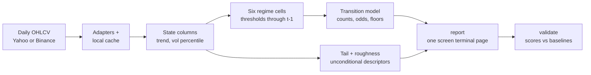

# julia-mandelbrot

> A market regime indicator for daily price series. It classifies the current trend and volatility state, estimates the odds of the next state, and renders the whole picture as a one screen terminal report. Data comes from public Yahoo Finance and Binance endpoints, and every computation runs on your machine.

Anyone who studies daily bars makes the same call every day: what kind of market is this right now. The call is harder than it looks. A trend read flips on a single candle, a volatility read gets judged by eye, and a regime change is only obvious once it is over. The same series supports several answers at once, and few tools separate those answers cleanly.

julia-mandelbrot computes a fixed set of state columns from daily OHLCV: a dimensionless trend score, a volatility percentile, a six cell regime classification, soft membership scores with an entropy read, transition counts with next state odds, a roughness estimate of realized volatility, and left tail descriptors. Classification thresholds come from expanding history through the previous bar, so no row ever sets its own standard.

The `report` command draws those columns as one dense terminal page for any ticker. The `validate` command scores the state columns against persistence and unconditional baselines, so a column that stops earning its place is visible in numbers, not in vibes.



## How it works

Trend is measured as a dimensionless score: the OLS slope of log price over 63 sessions, divided by the dispersion of those sessions. Raw slope has no invariant unit across assets; the normalized score does. Volatility is a percentile rank of realized volatility inside a 252 session window, which makes the scale relative to the asset itself.

The two dimensions split into six cells (low, mid, high trend crossed with low, high volatility). The cell boundaries are rolling quantiles of the same columns, estimated through the previous bar only. A row is marked valid when every window behind it is full.

A transition model counts past cell changes inside a 756 session window and turns them into next cell odds, conditioned on the current cell. A count floor of 30 keeps thin evidence from posing as a probability: below the floor the model pools all history, and below the pooled floor it reports nothing. Realized log volatility gets a variogram Hurst estimate over fixed lags 1 to 10, and the tail carries unconditional expected shortfall and drawdown. The `validate` command checks calibration, compares transition log loss against persistence and unconditional baselines, and runs a purged walk forward; a column that fails its check is demoted in the report.

## Quick start

Requires Python 3.10+ and [uv](https://docs.astral.sh/uv/).

```bash
git clone https://github.com/marcosconci1/julia-mandelbrot.git
cd julia-mandelbrot
uv sync
uv run julia-mandelbrot doctor
```

Render the one screen regime report:

```bash
uv run julia-mandelbrot report --source binance --ticker BTCUSDT \
    --start 2024-01-01 --end 2026-11-01 --out report.html
```

Score the state columns against baselines:

```bash
uv run julia-mandelbrot validate --source binance --ticker BTCUSDT \
    --start 2019-01-01 --end 2026-11-01
```

Use `--source yahoo --ticker SPY` for equities and FX. `doctor` checks the environment before the first real run.

## Documentation

* [Installation](docs/install.md)
* [The columns](docs/columns.md)
* [Validation](docs/validation.md)
* [Diagnostics](docs/diagnostics.md)
* [Design notes](docs/design.md)
* [Wiki](wiki/Home.md)

## License

MIT. See [LICENSE](LICENSE).
